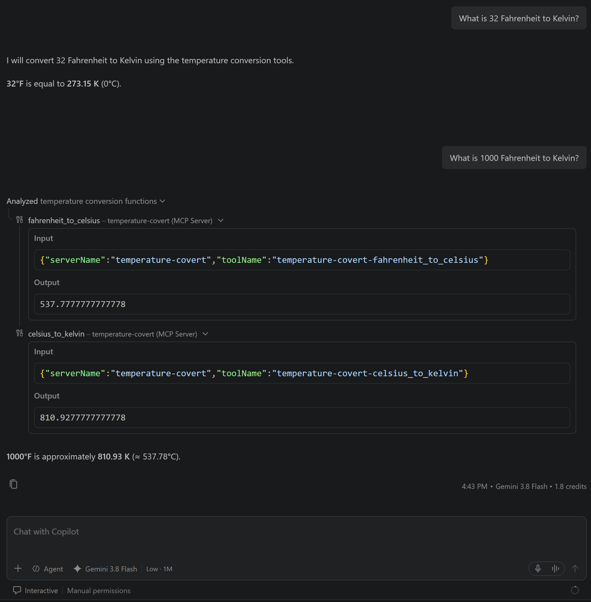

# Local stdio MCP server playground

This repository contains `TemperatureConvert.exe`, a small MCP server that uses
standard input/output (stdio). Use it to test connecting a local MCP server to
VS Code Chat; no package installation or separate server process is needed.

## Requirements

- Windows
- Visual Studio Code with MCP support and a chat model that can use tools

## Configure the server in VS Code

1. Open this repository folder in VS Code.
2. Create `.vscode/mcp.json` in the repository (create the `.vscode` folder if
   needed).
3. Add this configuration:

   ```json
   {
     "servers": {
       "temperature-convert": {
         "type": "stdio",
         "command": "${workspaceFolder}\\TemperatureConvert.exe",
         "args": []
       }
     }
   }
   ```

   **NOTE:** the TemperatureConvert.exe is copied from building another git repository **CSharpMcpDemo**'s `MCPServer/TemperatureConvert` project.

4. Save the file. Start `temperature-convert` using the **Start** control shown
   for the server in `mcp.json`.
5. Open Chat in Agent mode, open the tools picker, and make sure the
   `temperature-convert` tools are enabled.

VS Code launches the executable as a child process and communicates with it
over stdio. Do not start `TemperatureConvert.exe` separately in a terminal when
testing it from Chat.

## Try a conversion

Ask Chat to use the local server, for example:

- `Use temperature-convert to convert 20 degrees Celsius to Fahrenheit.`
- `Use temperature-convert to convert 300 Kelvin to Celsius.`


Example screen shot:  


The server exposes these tools:

- `celsius_to_fahrenheit`
- `celsius_to_kelvin`
- `fahrenheit_to_celsius`
- `kelvin_to_celsius`

To confirm that the server is working, check that Chat reports using one of
these tools and returns its conversion result. If it does not appear, check that
the server started successfully in `mcp.json`, that the workspace is this
repository, and that the tool is enabled in the Chat tools picker.
