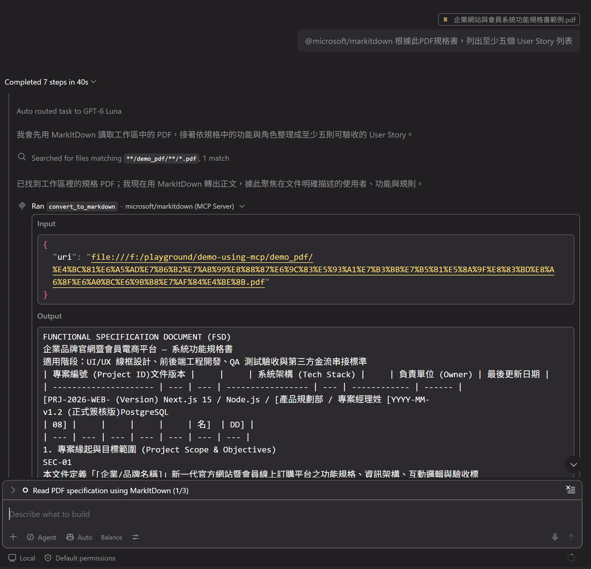

# Markitdown MCP Server to extract PDF content info

## Setup Markitdown MCP Server

Steps to use [Markitdown MCP Server](https://github.com/mcp/microsoft/markitdown) in VSCode Agent session:

1. Install [uv](https://docs.astral.sh/uv/getting-started/installation)
2. Manually install [markdown-mcp](https://pypi.org/project/markitdown-mcp/) using uv in console/terminal:
   ```sh
   uv tool install markitdown-mcp@latest
   ```
   Then verify it can run by:
   ```sh
   uv tool run markitdown-mcp --help
   ```
3. In **.vscode/mcp.json** MCP config file, add config as:
   ```json
    "microsoft/markitdown": {
        "type": "stdio",
        "command": "uv",
        "args": [
            "tool",
            "run",
            "markitdown-mcp"
        ],
        "gallery": "https://api.mcp.github.com",
        "version": "1.0.0"
    }
   ```

Then you should be able to use markitdown MCP server by typing `@microsoft/markitdown` in Agent session chat input UI.

## Demo using Markitdown MCP server

You can use the _demo_pdf/企業網站與會員系統功能規格書範例.pdf_ file as an example,

First, [add it as VSCode Agent context](https://code.visualstudio.com/docs/chat/copilot-chat-context#_add-files-as-context), then prompt as:

```
@microsoft/markitdown  根據此PDF規格書，列出至少五個 User Story 列表
```

Example screen shot:  


---