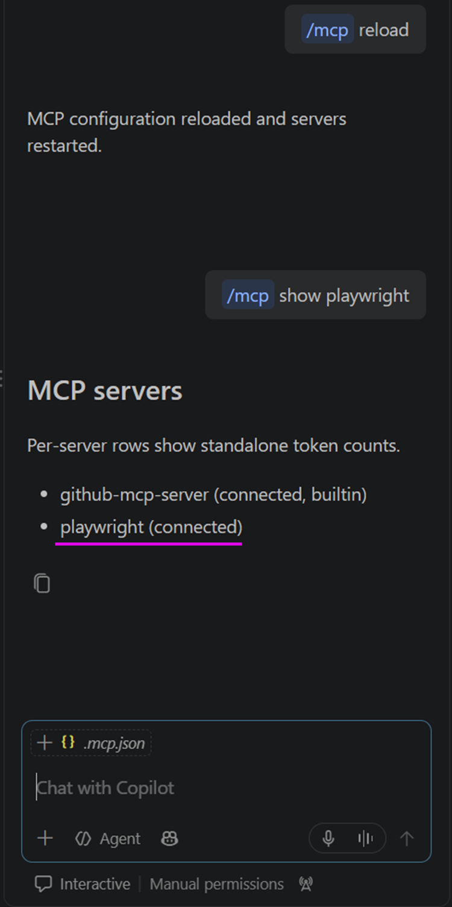
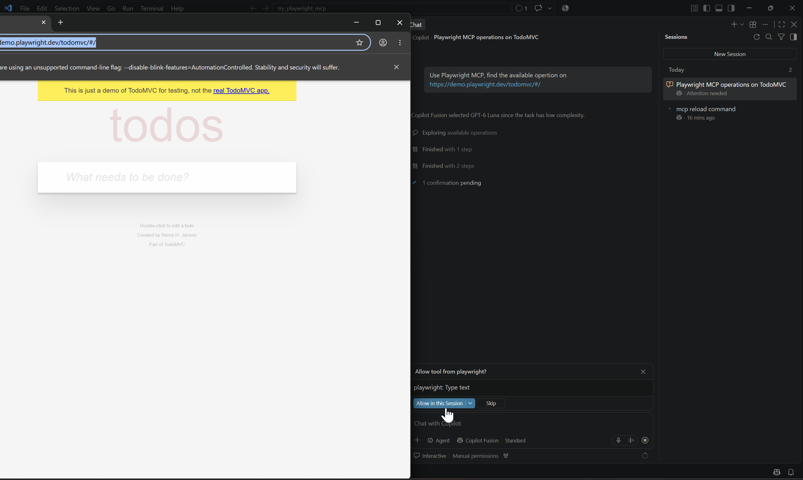
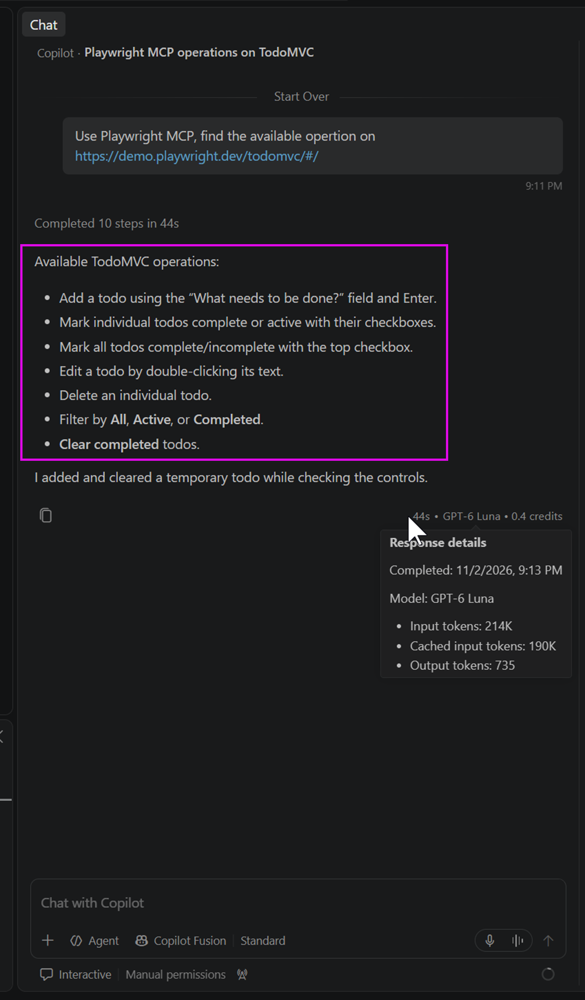

# Playwright MCP discover Todo MVC web site

## Install Playwright MCP

1. Downalod & Instal [Node.js LTS](https://nodejs.org/en/download)
2. Open VSCode with an empty folder, create a `.mcp.json` file as:
   ```json
   {
        "mcpServers": {
            "playwright": {
                "command": "npx",
                "args": [
                    "@playwright/mcp@latest"
                ]
            }
        }
   }
   ```

3. Open VSCode Chat View, type two prompts ( `/mcp reload` and `/msp show playwright` ) to verify Playwright MCP Servier is functional:  
   

## Use Playwright MCP

1. Create a new Chat session in VSCode Chat view, type following prompt:
   ```
   Use Playwright MCP, find the available operation on https://demo.playwright.dev/todomvc/#/
   ```
2. It should pop-up a new browser window with URL **`https://demo.playwright.dev/todomvc/#/`**, allow any operation that begin as `playwright:` which GitHub Copilot want to execute:  
   
3. Finally you should see GitHub Copilot has discovery available web site operations:
   
